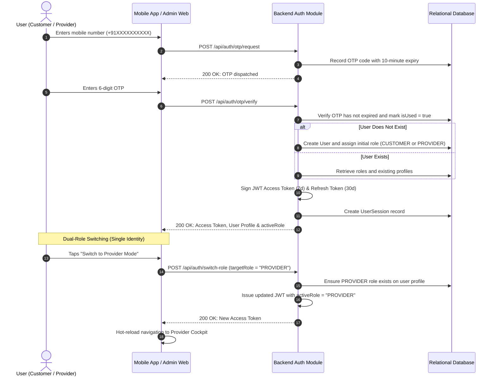

# QUICK APPOINTMENTS — AUTHENTICATION & MULTI-ROLE FLOW

## Security Rules
1. **Single Account per Phone Number**: Duplicate user rows for the same phone number are blocked by database unique constraints.
2. **Short-Lived OTPs**: OTPs automatically expire after 10 minutes and cannot be reused (`isUsed = true`).
3. **Role Guards (RBAC)**: Administrative endpoints enforce `requireRole(['ADMIN', 'SUPERADMIN'])` on every request.

