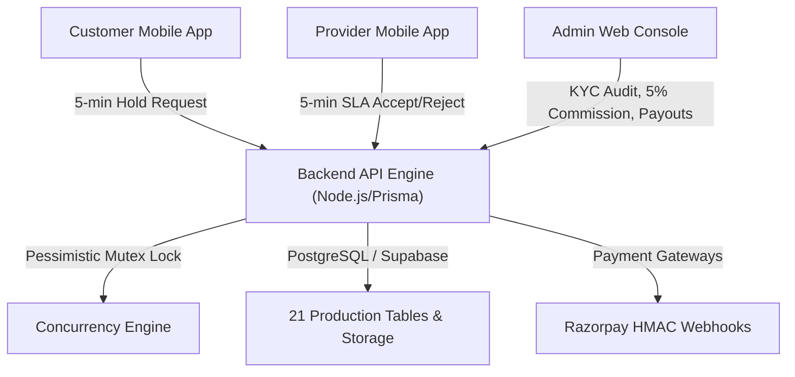
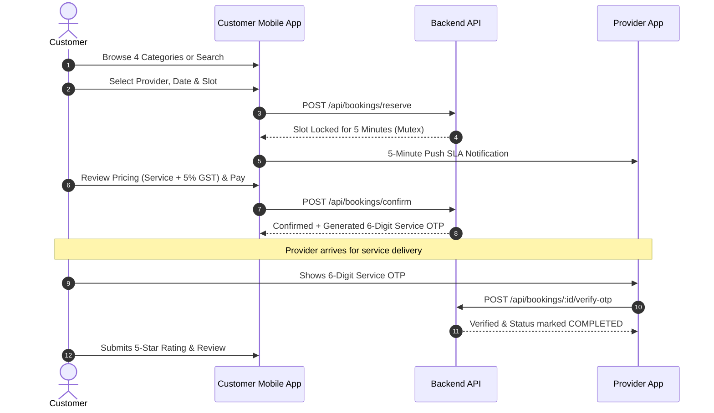
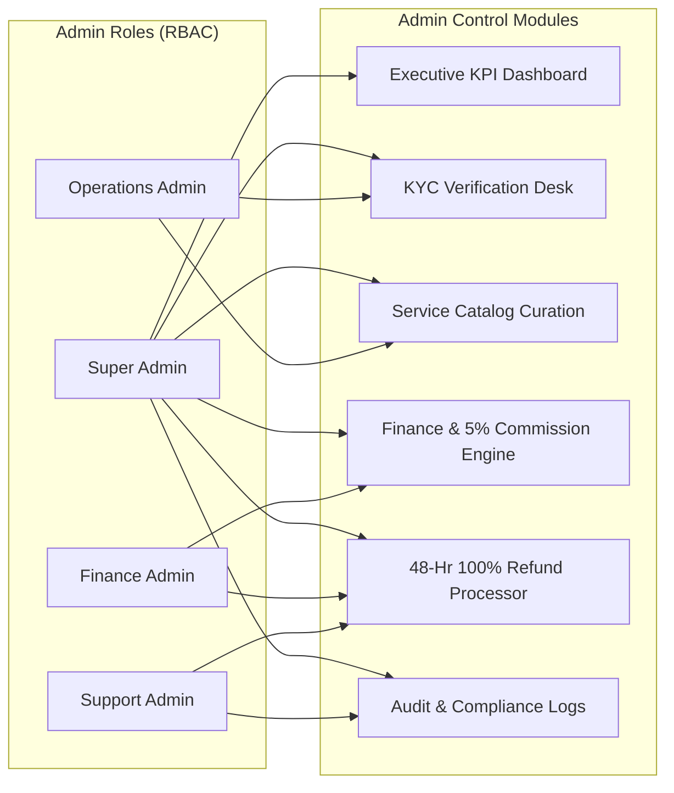
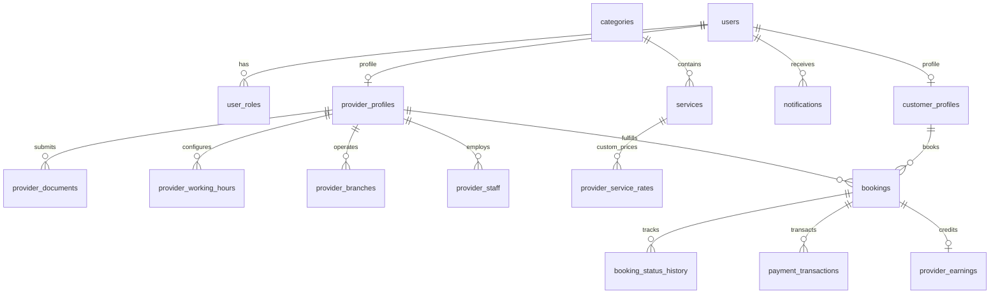

# QUICK APPOINTMENTS — COMPLETE MASTER PROJECT SPECIFICATION
**Platform**: Quick Appointments (Pan-India Appointment Marketplace)  
**Document Version**: 2.0 (Production Master)  
**Target Coverage**: Customer App, Provider App, Admin Web Panel, Backend Engine, Database Architecture  

---

## 1. Executive Summary & Core Platform Vision

**Quick Appointments** is an enterprise-grade, multi-role appointment booking ecosystem operating across India. The platform bridges the discovery and operational gap between customers seeking professional services and verified specialists providing them.

### The Problem It Solves
1. **Zero Double-Booking**: High-concurrency race conditions are eliminated using a pessimistic mutex locking engine.
2. **5-Minute Provider SLA**: Ensures rapid customer fulfillment or immediate intelligent rerouting to alternative nearby providers.
3. **Anti-Fraud Service Delivery**: Customer-generated 6-digit Service Verification OTP prevents phantom appointments and dispute friction.
4. **Transparent 5% Take-Rate**: Simple, post-discount commission calculation with next-day (T+1) provider payouts and guaranteed 100% customer refunds within 48 hours on cancellations.

---

## 2. Launch Strategy & Market Scope

| Parameter | Specification | Architectural Detail |
|---|---|---|
| **Coverage** | **Pan-India** | Dynamic city selector (`Mumbai`, `Bengaluru`, `Delhi NCR`, `Chennai`, etc.) with GPS proximity lookup. |
| **Launch Categories** | **4 Core Tiers** | 1. **Saloon & Beauty** (`saloon-and-beauty`) 2. **Healthcare (Doctor Appointment)** (`healthcare-doctor-appointment`) 3. **Education & Coaching** (`education-coaching`) 4. **Skilled Workers** (`skilled-workers`) |
| **Provider Types** | **Dual Entities** | 1. **Individual Specialists** (Solo practitioners, freelancers) 2. **Registered Businesses** (Salons, clinics, coaching institutes, contracting agencies with multi-staff & multi-branch support) |

---

## 3. System 1: Customer Application (Mobile)

The Customer Application delivers a frictionless, trustworthy booking journey from discovery to completed service.

### Customer Journey Flow

### Core Customer Screens & Capabilities
1. **Splash & Dual-Persona Auth**:
   - Phone number input with 6-digit SMS OTP verification.
   - Instant role switching toggle (**Customer Mode** ⇄ **Provider Mode**) on a single account.
2. **Home & Pan-India Discovery Screen**:
   - City selector and auto-detect GPS location.
   - Search bar across categories, services, and provider tags.
   - 4 Launch category quick-cards with service counts.
   - Featured top-rated verified providers badge.
3. **Provider Profile & Calendar Availability**:
   - Business branding, ratings, bio, experience years, service radius.
   - Aadhaar/GST verified trust shield.
   - Dynamic date picker skipping closed days (e.g. Sundays).
   - Real-time time slot grid excluding lunch breaks (13:00 - 14:00) and reserved slots.
4. **5-Minute Slot Reservation Modal**:
   - Real-time countdown timer (`05:00` minutes).
   - Pessimistic lock prevents any competing customer from grabbing the slot.
   - Price breakdown: Base price, applied discounts, 5% GST tax, total amount.
   - Payment selection: Full Online (UPI / Card / Netbanking via Razorpay), Advance Deposit, or Cash on Service.
5. **Post-Booking & Anti-Fraud Security**:
   - Booking reference generation (e.g. `QA-2026-XXXX`).
   - Secure **6-digit Customer Service OTP** displayed on the booking ticket.
6. **My Bookings Ledger**:
   - Filterable tabs: `Upcoming`, `Completed`, `Cancelled`.
   - 1-click cancellation with automated 100% refund policy.
   - Verified post-service rating and review submission.

---

## 4. System 2: Service Provider Application (Mobile)

The Provider Application is an operational cockpit tailored for solo freelancers and multi-staff business managers.

### Core Provider Modules & Operations
1. **Onboarding & KYC Verification Desk**:
   - Business details: Individual vs Registered Business entity.
   - Mandatory document uploads: **Phone OTP**, **Email**, **GST / Aadhaar Card**, and **Education / Professional Certifications**.
   - Profile state transitions: `PENDING` ➔ `UNDER_REVIEW` ➔ `APPROVED` or `REJECTED`.
2. **Multi-Branch & Multi-Staff Manager** (Businesses):
   - Add multiple physical branch locations (`provider_branches`) across cities.
   - Register staff specialists (`provider_staff`) and allocate individual schedules.
3. **Weekly Schedule & Working Hours Engine**:
   - 7-day schedule matrix (Monday to Sunday).
   - Configurable opening and closing times (e.g. `09:00` to `19:00`).
   - Daily break windows (e.g. `13:00` to `14:00`).
   - Day-off toggles (e.g. Sunday closed).
4. **Custom Services & Admin Publishing Approval**:
   - Providers customize pricing and duration for catalog services.
   - **Two-Tier Governance**: Custom rates remain in `PENDING` approval until an Admin verifies them.
5. **5-Minute Booking Request SLA Dispatcher**:
   - Incoming requests trigger loud alerts with a 300-second countdown.
   - 1-click **Accept** or **Reject**.
   - If unhandled in 5 minutes, request auto-expires, releases the slot lock, and re-routes the customer.
6. **OTP-Based Service Completion Screen**:
   - Provider enters the customer's 6-digit OTP upon arrival.
   - System verifies OTP atomically, transitions booking to `COMPLETED`, and credits net earnings to the provider's ledger.
7. **Earnings & Settlement Ledger**:
   - Real-time revenue breakdown: `Gross Bookings`, `Platform Fee (5%)`, `Net Provider Balance`.
   - Next-day (T+1) settlement tracking and bank transfer status.

---

## 5. System 3: Administrative Web Console (Admin Panel)

Built with React, Vite, Tailwind CSS, and Lucide icons, the Admin Console gives management complete operational, financial, and governance control.

### Detailed Admin Modules
1. **Executive KPI Dashboard**:
   - Real-time GMV (Gross Merchandise Value), 5% Platform Retained Commission, Total/Today's Bookings, and Pending KYC counters.
   - Quick action shortcuts to pending verifications and disputed bookings.
2. **KYC Verification & Document Inspection Desk**:
   - Live queue of unverified providers with submitted Aadhaar, PAN, GST, and trade documents.
   - Inline document viewer with 1-click `Approve`, `Request Info`, or `Reject with Reason`.
3. **Master Catalog & Publishing Control**:
   - Manage the 4 Launch Categories, slugs, icons, and display ordering.
   - Curate master service templates (base price, standard duration).
   - Approve or reject provider-submitted custom service rate cards.
   - City-level category toggles (enable/disable specific categories in specific cities).
4. **Finance, Commissions & Payouts**:
   - **Platform Commission Engine**: Set to **5.00% default**, calculated on post-discount subtotal. Dynamically adjustable across categories or revenue tiers.
   - **Rate Locking**: Historical bookings preserve their confirmed rate regardless of subsequent platform rate changes.
   - **T+1 Provider Payouts**: Batch settlement processing for verified completed bookings.
5. **Bookings Ledger & 48-Hour 100% Refund Processor**:
   - Master ledger of all bookings with customer, provider, slot, and payment references.
   - 100% refund workflow: Initiates refund back to the customer's original payment method via Razorpay within 48 hours and reverses provider ledger allocations.
6. **Enterprise Audit Trail**:
   - Immutable audit logs capturing admin user ID, IP address, timestamp, target entity, and payload details for every approval, refund, and rate alteration.

---

## 6. Financial Architecture & Commission Formulas

$$\text{Eligible Service Amount} = \text{Base Price} - \text{Discounts}$$
$$\text{Tax (GST 5\%)} = \text{Eligible Service Amount} \times 0.05$$
$$\text{Total Customer Paid} = \text{Eligible Service Amount} + \text{Tax}$$
$$\text{Platform Commission (5\%)} = \text{Eligible Service Amount} \times 0.05$$
$$\text{Provider Net Earnings} = \text{Total Customer Paid} - \text{Platform Commission}$$

### Example Calculation
- Customer selects ₹1,000 Service with ₹100 Coupon Discount:
  - Eligible Service Amount: ₹900
  - Tax (5% GST): ₹45
  - **Total Customer Charged**: **₹945**
  - **Platform Commission (5% on ₹900)**: **₹45**
  - **Provider Net Settlement**: **₹900** (Transferred next day via Admin console)

---

## 7. Database Architecture (Zero Seed Data / Clean Production)

The database schema is fully normalized across 21 production tables with cascading rules, check constraints, automatic `updated_at` triggers, and performance indexes.

### Complete 21 Production Tables Summary
1. `users`: Master identity (phone, email, password hash, status).
2. `user_roles`: Role assignments (`CUSTOMER`, `PROVIDER`, `ADMIN`, `SUPERADMIN`).
3. `otp_verifications`: Mobile login and verification codes.
4. `user_sessions`: JWT refresh tokens with user agent and IP tracking.
5. `customer_profiles`: Customer address, city, and GPS coordinates.
6. `provider_profiles`: Business details, KYC verification status, ratings, and service radius.
7. `provider_documents`: Aadhaar, PAN, GST, and trade certification file references.
8. `provider_working_hours`: 7-day schedule with open, close, and lunch break ranges.
9. `provider_branches`: Multi-branch locations for registered businesses.
10. `provider_staff`: Multi-specialist staff members with assignable calendars.
11. `categories`: 4 Launch categories with slugs, display order, and active toggles.
12. `services`: Master service catalog templates with base prices and durations.
13. `provider_service_rates`: Provider custom rates with admin `approval_status`.
14. `slot_reservations`: 5-minute pessimistic concurrency lock records.
15. `bookings`: Master appointments with references, pricing breakdown, and `service_otp`.
16. `booking_status_history`: State machine audit trail (`PENDING` ➔ `CONFIRMED` ➔ `COMPLETED`).
17. `payment_transactions`: Gateway transaction IDs and HMAC payloads.
18. `provider_earnings`: Net financial settlement ledger with settlement flags.
19. `commission_settings`: Dynamic take-rate engine (5% default).
20. `notifications`: In-app and push notification dispatch ledger.
21. `audit_logs`: Immutable security log for administrative actions.

---

## 8. Development & Deployment Guide

### Local Development Commands
From the workspace root (`E:\Bizools\Qucik Appoptiment`):
- **Full Stack Dev**: `npm run dev` (Concurrently boots Backend API on `4000`, Admin Web on `3000`, and Mobile on `3001`).
- **Backend Only**: `npm run start:backend`
- **Admin Panel Only**: `npm run start:admin`
- **Mobile Simulator Only**: `npm run start:mobile`

### Production Setup (Supabase)
1. Open the [Supabase SQL Editor](https://supabase.com/dashboard/project/ugxgtgvykauyydxoqouz).
2. Paste and run **[`database-migrations/run_supabase_migration.sql`](file:///e:/Bizools/Qucik%20Appoptiment/database-migrations/run_supabase_migration.sql)**.
3. All 21 clean tables, triggers, storage buckets (`kyc-documents`, `service-images`, `avatars`), and idempotent RLS policies are created instantly with **0% mock data**.
