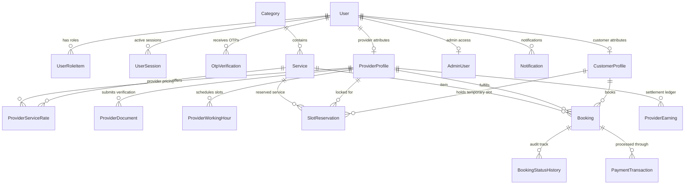

# QUICK APPOINTMENTS — DATABASE SCHEMA SPECIFICATION

## 1. Schema Topology

The database architecture is designed with high data integrity, strict foreign key constraints, explicit indexing on frequently filtered query dimensions (e.g. `(providerId, date, startTime)`), and soft states to preserve financial records and historical bookings.

---

## 2. Relational Table Dictionary

### Authentication & Users
- **`User`**: Primary account table. Identifies users by phone number. Stores hashed credentials, profile name, avatar, and active status.
- **`UserRoleItem`**: Composite role mapping (`CUSTOMER`, `PROVIDER`, `ADMIN`, `SUPERADMIN`). Enables dual-role users on a single phone identity.
- **`OtpVerification`**: Short-lived OTP table with expiration (`expiresAt`) and single-use flag (`isUsed`).
- **`UserSession`**: Refresh token rotation storage with user-agent, IP logging, and session revocation.

### Customer & Provider Profiles
- **`CustomerProfile`**: Coordinates customer address, GPS location, default booking preferences.
- **`ProviderProfile`**: Business/Individual provider records, verification status (`PENDING`, `UNDER_REVIEW`, `APPROVED`, `REJECTED`), experience, rating aggregate, working radius.
- **`ProviderDocument`**: Verification uploads (Aadhaar, PAN, Trade License) with administrative audit stamps.
- **`ProviderWorkingHour`**: Weekly availability matrix (0=Sun to 6=Sat) with open, close, and mid-day break periods.

### Dynamic Service Catalog
- **`Category`**: Root taxonomy (e.g., Salon & Grooming, Healthcare, Home Repairs, Consulting). Fully controllable via Admin.
- **`Service`**: Specific bookable service entity with duration, base price, and category foreign key.
- **`ProviderServiceRate`**: Provider custom pricing and duration adjustments within admin tolerances.

### Concurrency & Booking Engine
- **`SlotReservation`**: Distributed concurrency locking mechanism. When a customer selects a slot, a 10-minute pessimistic hold prevents double bookings. Auto-expires if checkout is not completed.
- **`Booking`**: Production booking ledger with unique `bookingRef` (e.g. `QA-2026-9812`), snapshot of prices, tax calculations, commission, and provider net payout.
- **`BookingStatusHistory`**: Immutable log recording every status transition (`CONFIRMED` -> `IN_PROGRESS` -> `COMPLETED`) with actor ID.

### Financials & Admin
- **`PaymentTransaction`**: Gateway reference (Razorpay/Stripe), payment status, and raw webhook signature verification.
- **`ProviderEarning`**: Ledger calculating platform commission split and settlement status for every completed appointment.
- **`CommissionSetting`**: Dynamic commission configuration by category, provider, or platform default.
- **`AuditLog`**: Security compliance log tracking administrative actions (KYC approval, fee modification, account suspensions).

