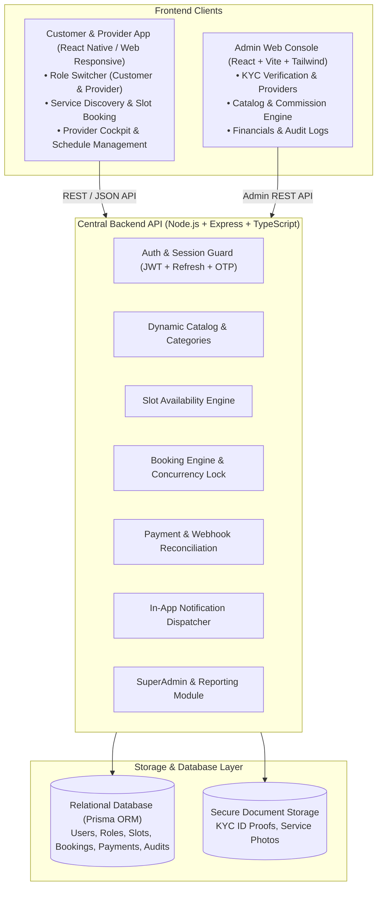
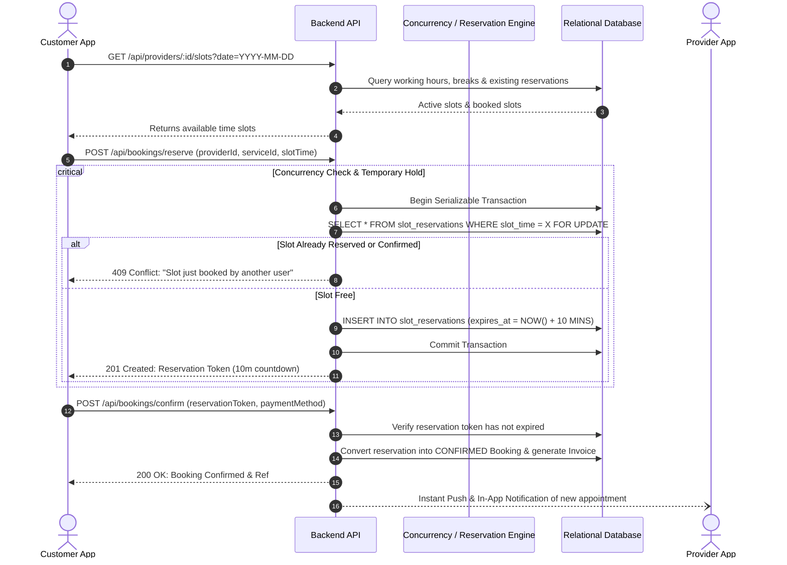

# QUICK APPOINTMENTS — TECHNICAL SYSTEM ARCHITECTURE

## 1. System Topology Overview



---

## 2. Monorepo Structure

```
quick-appointments/
├── assets/
│   └── branding/
│       └── logo.png              # Official extracted brand logo
├── documentation/                # Complete technical and product docs
│   ├── SYSTEM_ARCHITECTURE.md
│   ├── DATABASE_SCHEMA.md
│   ├── API_DOCUMENTATION.md
│   └── DESIGN_SYSTEM.md
├── packages/
│   ├── shared-types/             # Universal DTOs, Enums, Zod validation schemas, Design Tokens
│   │   ├── src/
│   │   │   ├── tokens.ts         # Brand colors, typography & spacing tokens
│   │   │   ├── models.ts         # User, Provider, Booking, Service interfaces
│   │   │   └── schemas.ts        # Zod request validators
│   │   └── package.json
│   ├── backend-api/              # Node.js + Express + TypeScript + Prisma ORM
│   │   ├── prisma/
│   │   │   └── schema.prisma     # Relational schema with migrations
│   │   ├── src/
│   │   │   ├── controllers/      # Handlers for Auth, Catalog, Bookings, Admin
│   │   │   ├── middleware/       # RBAC, Rate-Limiting, Concurrency lock
│   │   │   ├── services/         # Booking transaction & Slot reservation engine
│   │   │   └── server.ts         # Entry point & API routes
│   │   └── package.json
│   ├── admin-web/                # Modern React + Vite + Tailwind + Lucide SaaS Admin
│   │   ├── src/
│   │   │   ├── components/       # Shadcn UI-styled tables, modals, charts
│   │   │   ├── pages/            # Dashboard, KYC, Catalog, Bookings, Finance
│   │   │   ├── hooks/            # TanStack Query data hooks
│   │   │   └── App.tsx
│   │   └── package.json
│   └── customer-provider-mobile/ # Dual-mode Customer/Provider Mobile application
│       ├── src/
│       │   ├── customer/         # Discovery, Catalog, Slot picker, Checkout
│       │   ├── provider/         # Schedule settings, KYC status, Earnings, Bookings
│       │   ├── shared/           # Auth screen, Role Switcher, UI components
│       │   └── App.tsx
│       └── package.json
└── package.json                  # Root workspace configuration
```

---

## 3. High-Concurrency Slot Reservation Flow

To satisfy **Rule 9 & Rule 10 (Prevent double booking through concurrency-safe transactions & temporary reservations with expiration)**:



